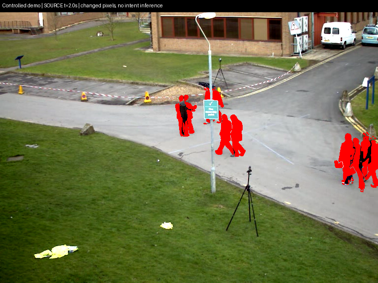
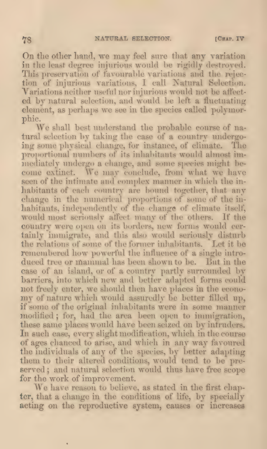

# Media interpretation: preserving evidence across formats

Research date: 2026-09-29. This is an experiment report, not an accepted architecture. [Collection](../README.md) · [Concern index](README.md) · [Raw experiment artifacts](experiments/media-lab/README.md).

## Finding

A useful conversion pipeline keeps extraction, supporting-model observations, and proposed interpretations distinguishable. In this experiment, OCR preserved book qualifications and a deliberately unfamiliar dog/fox sentence, but omitted the useful content of photographs and video. Vision recovered some of that content while introducing attribution errors, invented or missing anchors, repetitive output, and a negation error. Jev could reject a bad interpretation when it received independently retained source text. It could not authenticate a false caption when that caption was its only evidence.

The most useful result is a concrete source-linked investigation: source screenshot → controlled user decision → actual Python change → measured changed-pixel masks → playable demonstration. A second investigation connects an actual historical book scan, a public author tutorial, a controlled personal note, and old public implementation code. Its connections remain hypotheses; no user history was recovered in this concern.

## Sources and format coverage

[Source manifest](experiments/media-lab/sources.json) records public URLs, bytes, SHA-256, capture status and failures. [Derivative manifest](experiments/media-lab/derivatives.json) records page or time anchors and the original parent. Large original PDF and AVI files remain under `/tmp/knowledge-garden-media-lab/`, outside the repository. These are public-source caches, not private histories.

| Source | Acquired and tested representation | What the format contributes |
| --- | --- | --- |
| Darwin, *On the Origin of Species*, 1860 first American edition, NLM scan | Scanned PDF, embedded OCR blocks, rendered PNG and native Vision OCR; PDF pages 83, 84, 92, printed pages 77, 78, 86 | A real book page, typography, imperfect historical OCR and qualifications. A scan substitutes for a physical photograph of a book; camera distortion and glare were not tested. |
| OpenCV `vtest.avi`, pinned commit `d21a05f1afee9521f0a700dc4f22dd7dc5f7ac72` | Actual 79.5-second AVI, six PNG frames at 0/2/5/10/20/30 seconds, contact sheet, native MP4 perception over first 10 seconds | Temporal evidence and changes beyond transcripts. This video has no source audio stream; speech transcription was not tested. |
| OpenCV `fruits.jpg`, same pinned commit | Actual photographed fruit JPEG, OCR and vision | OCR yields no useful account of the fruit arrangement; vision supplies appearance, not weight or nutrition. |
| Tesseract `phototest.tif`, pinned commit `232ff181c66516116ec0e84c4963f70de15050fd` | Real TIFF, reference text, native OCR, converted PNG for API vision | The original says **dog jumped over fox**, rather than the familiar reverse phrase. A direct TIFF API request was not tested. |
| DEAP author tutorial and `selection.py`, pinned commit `8a96fd3a75026f7b30e835f595a5199c75634ddf` | ReStructuredText article and real Python implementation | Reference semantics, mutable state and evolutionary selection; no execution of downloaded DEAP code. |
| UCI Iris CSV | Deterministic rows/species counts and exact row anchor | 150 rows, 50 per class. The headerless CSV alone does not establish units. No semantic inference was needed for counts. |
| Archive scan metadata; controlled histories and local demonstration | XML pagination, JSON message IDs, Markdown note, actual Python versions and MP4 output | Page identity, adopted change, and explicit distinction between authored research history and real evidence. |

A Gutenberg HTML edition was fetched during source discovery but not used in the evaluation; acquisition is not tested format support. Arbitrary formats, handwritten notes, slide decks, audio, multilingual OCR and long-form video are not established by this run.

Sources are independently chosen research material, not URLs extracted from user conversations. No conversation URL destinations were fetched.

The TypeSafe [State documentation](https://docs.typesafe.ai/concepts/state) explicitly describes Jev as text-only; current [HTTP API](https://docs.typesafe.ai/api) and [value extraction cookbook](https://docs.typesafe.ai/cookbooks/pre_parsed_value_extraction_cookbook) support structured state and selection from supplied candidates. The [OpenRouter compatibility guide](https://openrouter.ai/docs/guides/community/typesafe-sdk) specifies `/api/v1/systemone` and cost passthrough. Supporting-model image/video integrations followed [image input](https://openrouter.ai/docs/guides/overview/multimodal/image-understanding) and [video input](https://openrouter.ai/docs/guides/overview/multimodal/videos) documentation. Documentation snapshots and access failures are retained. These statements describe current contracts; experimental failures below describe actual observed behavior.

## Experiment design

We authored 23 claim labels across six media situations before running Jev. Claims deliberately included supported content, contradictory statements, absent exact quantities, invented historical adoption, security intent, and unobserved trajectories. Each was judged from three representations: extractive text, Gemini observations, and Gemini interpretation output. Seven book claims also used embedded PDF OCR text. This produced 76 initial media judgments. One screenshot extractive representation used a controlled label scaffold rather than native OCR; it is explicitly retained in the fixture and is not evidence of general OCR capability.

Ten cross-source candidates tested useful analogy, same-word identity, historical influence, mutable-reference hazards, recorded adoption, contradictory adoption, and unrelated fruit evidence. Two caption-contamination cases tested what happens when a derived caption lies about dog/fox order. Seven later judgments audited actual generated observations against their named original sources. Fifteen diagnostic claims used a different vision model, and three reevaluated a bounded screenshot observation repair. There were **113 successful Jev requests**, with one Choice per request and additional usefulness Nouls in the ten connection cases. These are authored development evaluations over a small public corpus, not an independent holdout or user preference study.

Supporting perception made **25 successful requests**: 16 initial Gemini calls, four separate bounded repairs, four GPT-4o-mini diagnostics, and one specifically timed native-video repair. The initial run included both observation and interpretation prompts for seven image situations, an actual native-video input, and a cross-source candidate generator. Each raw response includes the exact prompt, input filename/hash, model, usage, and latency. Base64 payload duplication is avoided by referencing the pinned media bytes. Requests used temperature 0; this does not guarantee identical reruns.

Extraction uses macOS Vision OCR, PyMuPDF embedded OCR extraction, FFmpeg frame sampling and Python CSV parsing. Known IDs, counts, hashes, source revisions and page/time anchors remain code-owned. Generated regions and time descriptions are proposals requiring independent validation.

## Result: conversion fidelity and missing information

| Representation | Source-truth agreement | Observed difference |
| --- | --- | --- |
| Extractive/scaffold | 19/23 | Four abstentions: photograph content, changed red pixels and temporal movement/static contradiction were absent from text. |
| Gemini observation | 22/23 | Initial screenshot observation repeated signs until truncation and omitted the red overlay. |
| Gemini interpretation | 22/23 | The static-positions contradiction became unknown; descriptive content did not clearly preserve temporal comparison. |
| Embedded PDF OCR extraction | 7/7 | Book selection and speed/strength qualifications survived. This is embedded OCR text, not guaranteed exact transcription. |
| GPT-4o-mini diagnostic observation | 10/15 | Omitted speed/strength clause and temporal comparison; omitted red pixels. Jev mostly abstained on missing evidence. |
| Bounded screenshot repair | 3/3 | Recovered the overlay without establishing threshold or suspicious-person detection. |

“Source-truth agreement” compares manually inspected original media to Jev judgments over conversions. A missed original fact can mean that Jev correctly abstained after conversion lost it. These are not pure Jev accuracy figures and should not be pooled with different tasks. The initial media claim judgments made no unsupported promotions, but deliberately contaminated caption evidence did.

The TIFF reference and native OCR agree on the dog/fox order. The historical book preserves a stronger test: the wolf passage links fleetness to survival **provided** strength to master prey remains. GPT-4o-mini's `exact_visible_text` omits that entire qualification despite the prompt requesting it. Its broad natural-selection observations therefore cannot answer the speed-alone question. This is conversion loss, not a reason to pretend a concise caption is a source transcript.

Native video perception succeeded at the transport level, but the initial response emitted a repetitive list of “person walks across pavement” claims with image boxes instead of time anchors and truncated. A timed repair returned three numeric anchors at 1/3/5 seconds. The numbers are in range; their precise event timing has not been independently measured. The source clip has no audio stream, while provider usage reports 321 audio tokens. That is an accounting observation, not evidence of speech in the video.

## Failure: structured output and provenance

Eight of sixteen initial supporting-model responses ended with `finish_reason=length` and invalid JSON. Repeated signs and people consumed the output budget. All four bounded repairs, all four alternative-model outputs and the timed repair parsed. A parseable response still failed semantically: the repaired book connection says neutral variations “may be affected by natural selection” while its own quotation says they **would not** be affected. Jev rejected that candidate when provided the independent book extract.

The original cross-source generation assigned Darwin claims to the DEAP article source. A separate named-source audit rejected the same Darwin claim when its anchor was DEAP even though the claim was true in the book. This demonstrates why “some source in the bundle supports it” is an inadequate citation check.

The seven generated-source audit labels matched on 6/7. The remaining case describes Python deepcopy's memo mechanism as “DEAP's recursive loops.” Jev accepted it with 0.88 support despite our label treating attribution as unavailable. This is an ambiguous abstraction/attribution case, preserved for label review rather than concealed by relabeling it correct.

[Anchor audit](experiments/media-lab/anchor-audit.json) examines 101 observations from parseable outputs: 20 normalized boxes pass structural bounds, 50 fail the requested normalized-box contract, 12 provide only a source label, 11 lack an anchor, five supply uncontracted box objects, and three contain in-range numeric times. All 20 GPT-4o-mini observation boxes violated the requested normalized contract or used an alternate object form. A passing coordinate range is not semantic grounding. No region IoU or precise time localization benchmark was completed. Source-level page/time anchors generated by extraction code remain recoverable independently of these model guesses.

The deliberately false caption states fox-over-dog. Jev supported it from the caption alone. When trusted OCR was added, it selected contradicted. Jev's text-only verification cannot independently authenticate pixels, and a caption plus a paraphrase of that same caption is not independent verification.

## Rich demonstration 1: what changed and why

[Public source video](https://raw.githubusercontent.com/opencv/opencv/d21a05f1afee9521f0a700dc4f22dd7dc5f7ac72/samples/data/vtest.avi) · [Actual rendered demonstration](experiments/media-lab/controlled-demo.mp4) · [Controlled coding thread](experiments/media-lab/controlled-coding-thread.json) · [Before file](experiments/media-lab/controlled_demo.before.py) · [Changed file](experiments/media-lab/controlled_demo.py).

The public video is an actual OpenCV sample, not a fabricated description. The thread is a controlled history authored for this study. Its user turn `c3` explicitly adopts grayscale, blur and threshold 35 and requests source time anchors. The actual changed file implements those operations. It was executed over the first ten seconds at five frames/second. The screenshot corresponds to source t=2.0 seconds; the MP4 contains fifty actual output frames. Red marks changed pixels, not recognized people or suspicious intent.

Both before and after versions were run on the same fifty source frames. The before mask marks 527,879 changed pixels across frames; the changed mask marks 327,830. Maximum per-frame counts were 16,138 and 11,566. Those measurements establish that the masks differ and the latter is sparser. They do not establish accuracy or that removed pixels were noise: no object-level ground truth was available, and both preprocessing and threshold changed. The thread's initial “producing noise” assertion remains an authored experimental claim.

The evidence graph can therefore show `c3 → adopts preprocessing → changed file → produces output → uses video times`, while keeping the source screenshot incapable of proving the programmer's rationale by itself. Jev classified the actual controlled adoption as recorded and suspicious-person adoption as contradicted. This distinction is useful in a reasoning timeline and in a source explorer that lets a reader inspect the code and original frame.

## Rich demonstration 2: a useful unrecorded connection

[Book scan source](https://archive.org/details/101619491.nlm.nih.gov) · [Public author article](https://github.com/DEAP/deap/blob/8a96fd3a75026f7b30e835f595a5199c75634ddf/doc/tutorials/basic/part2.rst#L102) · [Controlled personal note](experiments/media-lab/controlled-personal-note.md) · [Old public project implementation](https://github.com/DEAP/deap/blob/8a96fd3a75026f7b30e835f595a5199c75634ddf/deap/tools/selection.py).

The note says a toy benchmark project lost alternatives when it retained only the fastest configuration. It was authored now for this experiment; it is not recovered personal history. DEAP is a real old public project, not evidence that this user owns or previously used it. The book scan discusses changing environmental conditions, favourable/injurious/neutral variations, and elsewhere the speed/strength tradeoff. The article warns that selection returns references rather than duplicates. The implementation contains selection methods and a double tournament that considers size to control bloat.

Three candidate relationships were judged useful enough to investigate: changed workloads as an analogy to changed environments (usefulness Noul 0.57), speed/strength as a benchmark tradeoff analogy (0.57), and the article's mutable-reference warning as a possible retained-configuration failure mode (0.67). All three were classified hypothesis. These values are observations, not chosen display thresholds or user preference scores.

The stronger claim that the user's project was inspired by Darwin was not established. Jev called it contradicted rather than unsupported, exposing an epistemic-status error: absence of history is not disproof of influence. Biological selection and DEAP `selTournament` were rejected as the same individual entity; fruit evidence was rejected as proof of benchmark diversity benefits. A connection can be valuable without promoting a historical claim or asserting the analogy proves a technical design.

## Costs, limitations and next experiment

[Offline summary](experiments/media-lab/summary.json) records the ledger. Jev resolved to `typesafe/jev-1.13-20260917`: 113 requests, 210,226 input tokens, 4,982 output tokens, **$0.008829492** reported router cost. Supporting calls used `google/gemini-2.5-flash-lite` and `openai/gpt-4o-mini`: 25 requests, 104,940 input tokens, 28,202 output tokens, **$0.017115219** reported router cost. Combined observed router cost is **$0.025944711**.

Sixteen supporting responses marked BYOK and reported router `cost=0`, while upstream inference metadata remained nonzero. Supporting responses report **$0.026221** total upstream inference cost metadata. This includes both BYOK and router-paid requests; do not add it to the router cost and call that a bill. The ledger is not a complete account reconciliation and excludes coding-agent, extraction-runtime and any external BYOK account charges. Requested supporting model IDs were returned without an immutable dated version; unlike Jev, the exact model build cannot be recovered from these responses.

Access failures are part of the record: Manim and DEAP hosted documentation returned 403, an initial Archive identifier returned empty metadata, an incorrect Tesseract master ref returned 422, and obsolete OpenRouter image-doc paths failed. Pinned raw author/code sources and Archive search recovered useful material. API transport succeeded for all recorded experiments; parse, semantic and anchor failures remain distinct.

The next discriminating experiment should annotate regions and events independently, reserve unseen media, and compare concise source-ID-constrained observations against OCR plus original-region lookup. Evaluate candidate recall separately from grounded citation correctness. Include handheld book photographs, diagrams, audio with tone, long videos and document tables. A reusable source explorer should expose conversion omissions and permit recovery of originals; a wiki can then generate prose as a separate, evidence-linked capability. Promotion policy, speculative-link visibility, OCR/vision escalation and default navigation remain unresolved.
